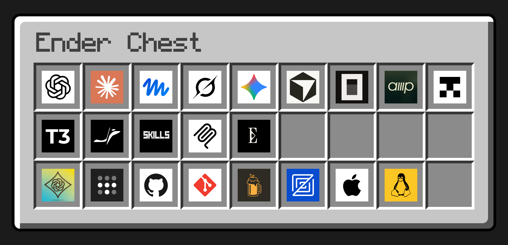

# Ender Chest

`ec` keeps development machines in sync. It applies a Git-backed config checkout, installs shared agent skills, and checks or updates machines over Tailscale and SSH.

The CLI is native Zig for macOS and Linux. Installed binaries need neither Node nor Zig. Git, curl, and SSH handle repository, HTTP, and remote operations.

## Install

The recommended installer downloads a native binary for macOS 13+ or Linux, on ARM64 or x86-64. It verifies the release's SHA-256 checksum and installs `ec` in `~/.local/bin`. It needs no compiler, Node, or sudo.

```sh
curl -fsSL https://github.com/KayleeWilliams/ender-chest/releases/latest/download/install.sh | sh
export PATH="$HOME/.local/bin:$PATH"
ec --help
```

Add the PATH line to your shell profile if needed. The installer leaves shell profiles and machine config untouched. It uses `sha256sum` or `shasum` for verification. A failed download or checksum leaves the existing binary in place.

Pass `--version 0.0.1` to pin a release or `--install-dir /your/bin` to choose a destination. Append these options to `sh -s --`:

```sh
curl -fsSL https://github.com/KayleeWilliams/ender-chest/releases/latest/download/install.sh \
  | sh -s -- --version 0.0.1 --install-dir "$HOME/.local/bin"
```

`EC_VERSION` and `EC_INSTALL_DIR` set the same defaults. `EC_RELEASE_REPO=owner/repo` selects a fork's releases. The installer uses authenticated `gh` when available and curl for public downloads otherwise.

### npm

The npm package includes all four native binaries. It requires Node 20+ and runs without install scripts or additional downloads:

```sh
npm install --global ender-chest
ec --help
```

The package name is `ender-chest`, and the command is `ec`. Each [GitHub release](https://github.com/KayleeWilliams/ender-chest/releases) also includes an npm tarball for offline installation.

## Get started

Create your config repo from [ender-chest-template](https://github.com/KayleeWilliams/ender-chest-template) with **Use this template**, then follow [its README](examples/config/README.md#start) to clone and sync it.

The template is published from [examples/config](examples/config/README.md) with each release. For instructions tied to one codebase, copy [examples/project](examples/project/AGENTS.md) into it.

- [Config reference](docs/config.md): `ender-chest.toml`, agent settings, skills, profiles, and recipes.
- [Plugins](docs/plugins.md): the built-in plugins, writing your own, and secrets.
- [Devices](docs/devices.md): checking and syncing every machine over SSH.

## Commands

```sh
ec sync                     # pull and apply this machine's config
ec sync --all               # sync every reachable machine that is behind
ec push                     # capture portable config, commit, and push
ec push --dry-run           # capture into the checkout without committing
ec verify                   # read-only checks
ec status                   # every machine's ec version and config commit
ec plugin list              # show enabled plugins and their commands
ec secret set NAME          # save a secret that plugin settings use
```

Use `ec <command> --help` for options and effects. `--json` produces one result on stdout, with diagnostics on stderr. `ec --help --json` describes commands, typed options, defaults, and side effects without reading config or making network requests.

## Updates

CLI releases come from `KayleeWilliams/ender-chest`, independently of your config remote. `EC_RELEASE_REPO=owner/repo` selects a fork's releases. If a fork's releases are private, each device needs `GH_TOKEN`, `GITHUB_TOKEN`, or `gh auth login`. These credentials stay local.

Run `ec update` to install the latest release. It downloads the binary for your machine, checks its sha256 against the release manifest, runs it once, and then replaces the `ec` you ran. A failed step leaves the old binary in place. `ec update --check` reports the latest release without installing it, and `--json` returns the versions and release notes link.

`ec sync` installs a newer release before it applies your config, then resumes with the new binary. It never installs an older release, and it leaves development builds alone.

After an interactive command such as `ec verify`, ec says when a newer release exists:

```text
Update available 0.0.5 → 0.0.6 · Run ec update
```

The notice appears at most once a day. The check sends one request to the GitHub releases API at most once a day, with no account or command details, and gives up after about three seconds. `ec sync`, `ec update`, plugin commands, `--json`, CI, and output that is not a terminal skip it. Set `EC_NO_UPDATE=1` or `NO_UPDATE_NOTIFIER=1` to turn off the notice; `EC_NO_UPDATE=1` also stops sync from installing releases and `ec status` from reading the latest release.

If you installed with npm, `ec update` prints the npm command for the newer version. For a project dependency, update `ender-chest` in that project. Forks still use their GitHub tarballs.

Releases build ARM64 and x86-64 binaries for macOS 13+ and Linux musl.

## Development

Use Node 24 and pnpm 11.25.0, pinned in the repository. Workspace commands run through Turborepo. Ultracite supplies Oxlint and Oxfmt, with the same custom anti-slop rules as Inth. Zig uses its native formatter.

```sh
git clone https://github.com/KayleeWilliams/ender-chest.git
cd ender-chest
pnpm install
git config core.hooksPath .githooks
pnpm check
pnpm format
pnpm build
```

The source launcher `./ec` builds and runs the CLI. The build wrapper downloads Zig 0.16.0 when needed and verifies its pinned checksum. The first build needs Git, curl, tar, and xz. To install your build:

```sh
mkdir -p ~/.local/bin
install -m 755 packages/ec/zig-out/bin/ec ~/.local/bin/ec
```

The hooks in `.githooks` check each commit and push for secrets and private hostnames; [AGENTS.md](AGENTS.md) explains the pattern file they read.

`pnpm check` runs lint, type checks, Vitest integration tests, and native Zig tests. The integration tests exercise the compiled CLI in temporary homes and Git repos, including HTTP requests, UDP packets, config uploads, and local credential handling.

```text
packages/ec/src/      native Zig implementation
packages/ec/test/     Vitest integration tests and fixtures
examples/config/      the config template, published to ender-chest-template
examples/project/     example instructions for one codebase
tools/                build, release, and lint tooling
docs/                 config, plugin, and device guides
```

Run `pnpm --filter @ender-chest/native <script>` to target the CLI package. `./ec` builds and runs it without requiring Node. CI checks the workspace on macOS and Linux, builds all four native targets, and scans Git history for secrets.

[Tegami](.tegami/README.md) opens version PRs from patch changelogs. After the version PR merges, the release workflow validates and tests the native packages, publishes `ender-chest` to npm using trusted publishing, and uploads the binaries, checksums, installer, and npm tarball to GitHub Releases. When `TEMPLATE_TOKEN` is set, it then publishes `examples/config` to ender-chest-template.

[FX](https://github.com/vercel-labs/fx) informed the native binary and Zig test setup. [Inth](https://github.com/inthhq/inth/tree/main/packages/cli) informed grouped commands, scoped help, typed discovery, and stable errors. Ender Chest uses its own implementation.

MIT licensed. The native binaries include the components listed in [third-party notices](THIRD_PARTY_NOTICES.txt).
