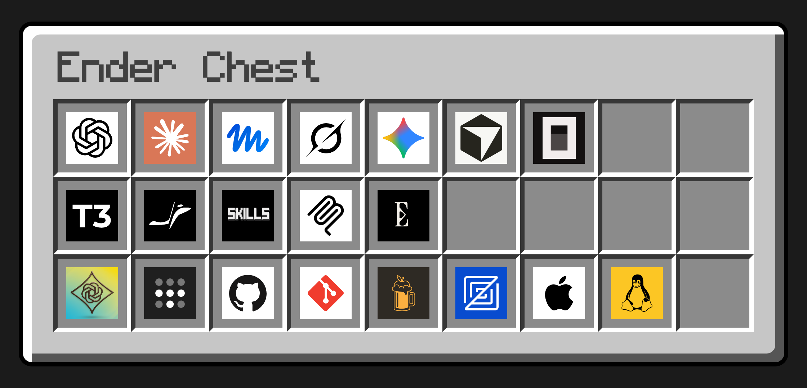

# Machine config

A config checkout for [Ender Chest](https://github.com/KayleeWilliams/ender-chest). `ec sync` applies it to each of your machines: your agent instructions and settings for Claude Code, Codex, Grok, Cursor, Meta Muse Code, Gemini CLI, and OpenCode, a code review skill, and your Git config.

## Start

Create your own copy with **Use this template** on [ender-chest-template](https://github.com/KayleeWilliams/ender-chest-template), and make it private. [Install `ec`](https://github.com/KayleeWilliams/ender-chest/blob/main/README.md#install), then clone your copy:

```sh
git clone https://github.com/YOUR-NAME/my-machine-config.git ~/my-machine-config && cd ~/my-machine-config
```

Edit these files:

- [agents/shared/AGENTS.md](agents/shared/AGENTS.md): how you want agents to work in every project.
- [git/gitconfig.local.example](git/gitconfig.local.example): your Git identity, copied once to `~/.gitconfig.local` on each machine.
- [DEVICES.md](DEVICES.md): your machines.
- [Brewfile](Brewfile): the packages each machine installs.

Sync replaces `~/.gitconfig` with [one](home/.gitconfig) that includes `~/.gitconfig.local`. If you already have a `~/.gitconfig` and no `~/.gitconfig.local`, move yours aside first so your identity and credential helpers keep working:

```sh
mv ~/.gitconfig ~/.gitconfig.local
```

Then apply the checkout:

```sh
ec sync --skip-packages
```

Sync sets up only the agents installed on each machine, so the [agents](agents) folders for agents you don't use do nothing. Sync [keeps a backup](https://github.com/KayleeWilliams/ender-chest/blob/main/docs/config.md#sync-and-push) of each file it replaces. Drop `--skip-packages` to install the Brewfile too; on a Mac without Homebrew, sync installs Homebrew first, which asks for your password.

Commit and push your edits. On each other machine, install `ec`, clone, move `~/.gitconfig` aside as above, and run the same `ec sync`.

## What's here

| Path | Use |
| --- | --- |
| [ender-chest.toml](ender-chest.toml) | What sync applies: files, packages, setup steps, and plugins |
| [agents/shared/AGENTS.md](agents/shared/AGENTS.md) | Your instructions for every agent |
| [agents/claude/settings.json](agents/claude/settings.json) | Claude Code settings, merged into `~/.claude/settings.json` on every sync |
| [agents/codex/config.toml](agents/codex/config.toml), [agents/grok/config.toml](agents/grok/config.toml) | Codex and Grok settings, copied only to a machine that has none |
| [agents/cursor/cli-config.json](agents/cursor/cli-config.json) | Cursor CLI settings, merged on every sync |
| [agents/muse/settings.json](agents/muse/settings.json) | Meta Muse Code settings, merged on every sync |
| [agents/gemini/settings.json](agents/gemini/settings.json) | Gemini CLI settings, merged on every sync |
| [agents/opencode/opencode.json](agents/opencode/opencode.json) | OpenCode settings, merged on every sync |
| [skills/review-changes](skills/review-changes/SKILL.md) | A code review skill for every agent |
| [home/.gitconfig](home/.gitconfig) | Your `~/.gitconfig` |
| [AGENTS.md](AGENTS.md) | Tells agents how to edit this checkout. Sync doesn't install it |

To manage a file you already have, such as `~/.zshrc`, see [sync and push](https://github.com/KayleeWilliams/ender-chest/blob/main/docs/config.md#sync-and-push).

## More

- [Config reference](https://github.com/KayleeWilliams/ender-chest/blob/main/docs/config.md): every `ender-chest.toml` key, where sync installs each file, skills, and recipes for shell setup and work identities.
- [Plugins](https://github.com/KayleeWilliams/ender-chest/blob/main/docs/plugins.md): shared MCP servers, model proxies, and the other built-in plugins, and how secrets are stored.
- [Devices](https://github.com/KayleeWilliams/ender-chest/blob/main/docs/devices.md): checking and syncing every machine over SSH.
- [Project instructions](https://github.com/KayleeWilliams/ender-chest/tree/main/examples/project): an `AGENTS.md` for a single codebase.

This template is dedicated to the public domain under [CC0 1.0](https://creativecommons.org/publicdomain/zero/1.0/). Copy and change it without credit.
