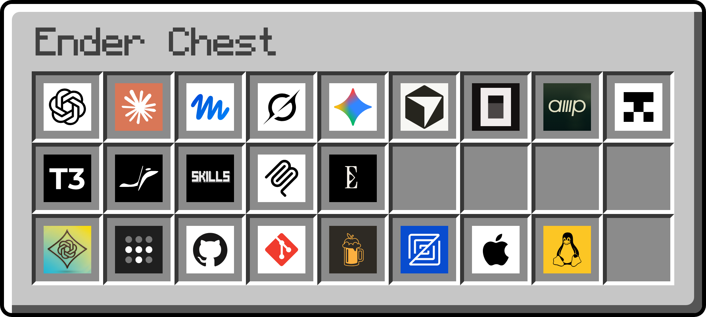

# Ender Chest

`ec` syncs development-machine config and agent skills. This package contains native binaries for macOS 13+ and Linux on ARM64 and x86-64. The npm launcher needs Node 20 or newer. It passes arguments, stdin, stdout, and stderr to the native executable.

No install scripts, compiler, or additional binary downloads are required. Install a release tarball with `npm install --global ./ender-chest-VERSION.tgz`, then run `ec --help`. Installing the CLI does not apply any machine config. `ec update` prints the commands that install a newer tarball.

For the curl installer, example config, and command reference, see the [repository](https://github.com/KayleeWilliams/ender-chest). The curl installation runs directly without Node.
